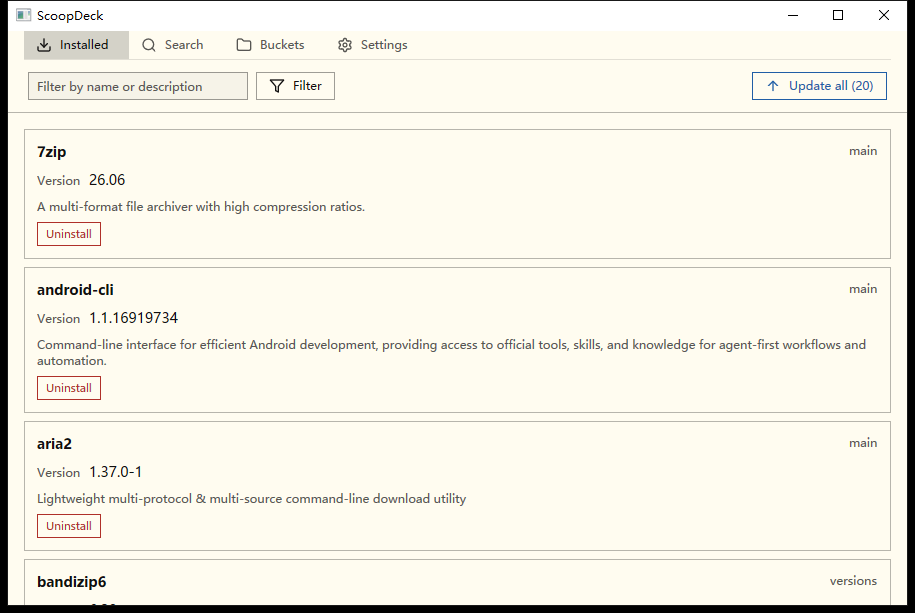
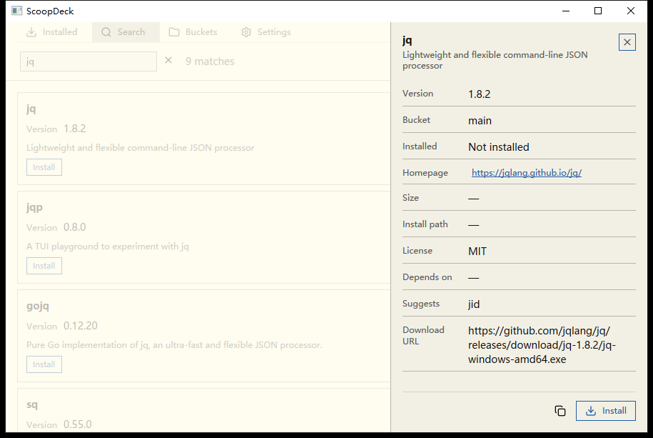
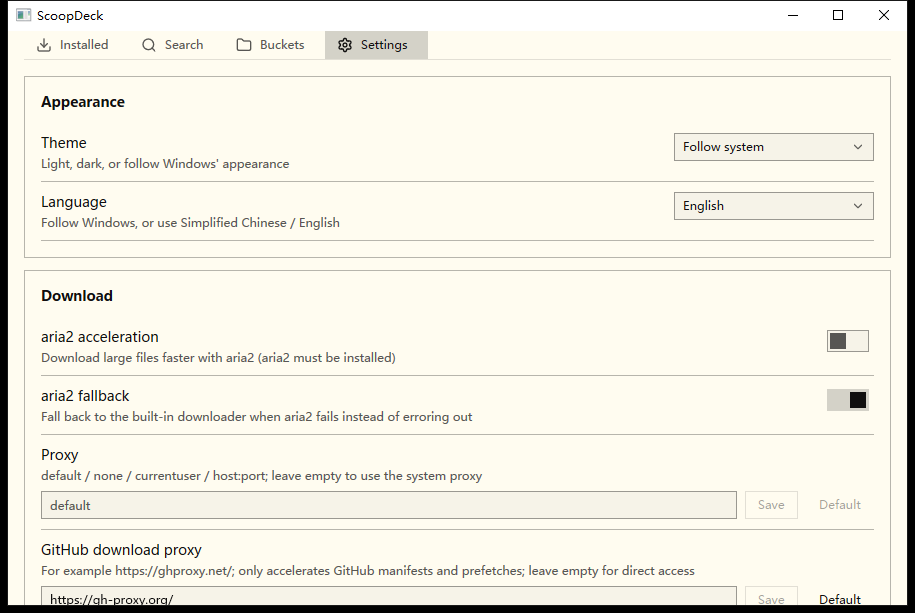

# ScoopDeck


$)

English | [简体中文](./README.zh-CN.md)

A native Windows GUI for the [Scoop](https://scoop.sh) package manager. The interface is built with TSX ([nsh](https://nsh.dev)), while Rust handles reading and writing Scoop directories, manifests, cache, and configuration. Actual package installation, updates, and uninstallation are delegated to `scoop`.

ScoopDeck does not maintain a separate package database; it organizes your local Scoop environment into a searchable, filterable, and queue-driven desktop app. Closing the window hides the app to the system tray so background downloads can continue—use **Exit** (`退出`) in the tray menu to quit completely.

> Supports Windows 10 1809+ and Windows 11 only. The UI is available in Simplified Chinese and English, follows the Windows language by default, and can be switched in Settings.

## Screenshots

| Installed | Package details |
| --- | --- |
|  |  |



## Features

### Installed

- Lists package name, installed version, latest version, source bucket, and description.
- Filters by keyword, update status (All / Updatable / Up-to-date), and source bucket.
- Supports single-package update/uninstall and **Update All** (`全部更新`) based on the active filter.
- Side detail sheet displays homepage, license, dependencies, suggestions, download URL, notes, install path, disk usage, and manifest path, with one-click package name copying.
- Automatically refreshes the installed list when refocusing the window after running `scoop` externally.

### Search & Install

- Aggregates manifests across all locally added buckets and searches by package name and description (no remote online index).
- Ranking priority: exact name match → name prefix → name substring → description substring (shorter names first on ties, capped at 100 results).
- Sends a `HEAD` request to estimate download size before installation; displays `下载大小未知` (unknown size) when `Content-Length` is unavailable.
- Marks already installed packages as `✓ 已安装` in search results.

### Download & Install Queue

- Runs up to 3 downloads in parallel while keeping installs and uninstalls strictly serial (one at a time).
- Tracks stages across preparing, downloading, verifying, extracting, and finalizing; shows a percentage when known or stage text otherwise.
- Allows canceling queued, waiting, or downloading tasks; hides cancellation during verifying, extracting, and finalizing stages to prevent half-installed apps. Uninstallation cannot be canceled.
- Retains failed tasks in the queue for retry or dismissal, and summarizes success/failure counts when a batch finishes.
- Docks a collapsible queue panel at the bottom of the window (collapsed by default; click `队列（n）` to expand).
- Updates the system tray tooltip with active task and queue counts. Runs as a single instance and persists window size and placement.

### Bucket

- Displays added buckets, manifest counts, and git origin URLs.
- Adds official known buckets with one click or custom buckets by name and git repository URL.
- Edits a bucket's origin URL or removes a bucket (removing a bucket only deletes local manifests without uninstalling packages).

### Settings & Maintenance

- Reads and writes `%USERPROFILE%\.config\scoop\config.json` directly (atomic replacement preserving unknown keys) for whitelisted boolean flags, proxy, default architecture, shim implementation, Scoop repo/branch, and GitHub token.
- Provides a ScoopDeck-only GitHub download proxy (e.g., `https://ghproxy.net/`) for GitHub manifests and prefetching without polluting Scoop's own configuration.
- Runs `scoop update` with one click (`立即更新`) to update Scoop itself and all buckets.
- Switches theme appearance between System, Light (Flexoki Light), and Dark (Tokyo Night) with instant effect and persistence.
- Switches the interface language between System, Simplified Chinese, and English with instant effect and persistence.
- Exports a Scoopfile via `scoop export` or imports buckets and missing apps from a Scoopfile (locking other heavy operations during import).
- Displays download cache size/file count, clears download cache, and cleans up old version directories across all installed apps.
- Automatically adapts layout when window width is below `900`: tables switch to cards and wide setting rows stack vertically.

## Getting Started

### Requirements

- Windows 10 1809+ or Windows 11.
- [Scoop](https://scoop.sh) installed and working (ScoopDeck also checks the default install path if `scoop` is not in `PATH`).
- If Scoop is not installed yet, run in a standard user PowerShell:
  ```powershell
  Set-ExecutionPolicy RemoteSigned -Scope CurrentUser
  irm get.scoop.sh | iex
  ```

### Run or Package from Source

Building ScoopDeck requires:

1. **Rust Toolchain** ([rustup](https://rustup.rs), Edition 2024 requires Rust 1.85+): use the MSVC toolchain with Visual Studio Build Tools ("Desktop development with C++" and Windows SDK).
2. **nsh CLI** (`>= 0.7.1`):
   ```powershell
   irm https://nsh.dev/install.ps1 | iex
   # Or install via Scoop:
   scoop install https://github.com/longbridge/nsh/releases/latest/download/nsh.json
   ```

Run from the repository root:

```powershell
# Start development mode (initial compilation takes a while)
nsh run

# Or package a standalone Windows executable (output under .nsh\out)
nsh package --target windows
```

> If ScoopDeck prompts `未检测到 Scoop` on startup, follow the on-screen guide to install Scoop and click `重新检测` (Re-detect), or restart ScoopDeck.

### Install with Scoop

The release page carries a `scoop-deck.json` manifest with the archive hash:

```powershell
scoop install https://github.com/JQiue/scoop-deck/releases/download/v0.1.0/scoop-deck.json
scoop update scoop-deck
```

The manifest installs the release zip, adds a Start menu shortcut, and keeps the app's `nsh/` runtime next to the executable. It does not use `scoop config` for updates; update it with `scoop update scoop-deck`.

### Download from GitHub Releases

Open the [latest release](https://github.com/JQiue/scoop-deck/releases/latest) and download `ScoopDeck.zip`. Or do it from PowerShell:

```powershell
$url = "https://github.com/JQiue/scoop-deck/releases/latest/download/ScoopDeck.zip"
Invoke-WebRequest $url -OutFile ScoopDeck.zip
Expand-Archive ScoopDeck.zip -DestinationPath .
.\ScoopDeck\ScoopDeck.exe
```

Keep the `nsh/` folder next to `ScoopDeck.exe`; run the extracted copy rather than the executable inside the zip. To check the download, compare its SHA-256 with the `hash` in the release's `scoop-deck.json`:

```powershell
(Get-FileHash .\ScoopDeck.zip -Algorithm SHA256).Hash.ToLower()
```

`v0.1.0` ships as a portable zip, not an installer. The executable is not code-signed, so Windows SmartScreen may warn; continue only if the hash matches.

## How It Works & Data Files

### Core Mechanisms

- **Installed List**: Reads manifests under `<Scoop Root>\apps\<app>\current`, supporting both new (`scoop-manifest.json` / `scoop-install.json`) and legacy (`manifest.json` / `install.json`) filenames. Latest versions come from bucket manifests; URL-installed packages fetch remote manifests first and fall back to local manifests on network failure.
- **Catalog Cache**: Scans `<Scoop Root>\buckets\<bucket>\bucket\*.json` and caches the catalog at `%LOCALAPPDATA%\ScoopDeck\catalog.json`, keyed by each bucket's git `HEAD` (or directory modification time for non-git buckets).
- **Prefetch & Fallback**: Resolves the download URL for the target architecture and writes into Scoop's cache using its exact naming rule: `<app>#<version>#<sha256(raw url with fragment)[0..7]><ext>`. Downloads to `<name>.download` first, verifies hash if provided, renames, and invokes `scoop install` or `scoop update`. If prefetching fails for any reason, it falls back seamlessly to letting Scoop download.
- **Progress Parsing**: When output is redirected, Scoop prints `Downloading <url> (<size>)`. ScoopDeck extracts total bytes from this line and watches the cache file grow to compute percentages, while parsing stdout for verifying, extracting, and finalizing stages.

### Data & State Paths

| Path                                               | Purpose                                                                                                                                                        |
| -------------------------------------------------- | -------------------------------------------------------------------------------------------------------------------------------------------------------------- |
| `%USERPROFILE%\.config\scoop\config.json`          | Scoop configuration file (Settings tab modifies whitelisted keys only; `use_sqlite_cache` is intentionally excluded because it requires Scoop's side effects). |
| `%LOCALAPPDATA%\ScoopDeck\settings.json`           | ScoopDeck's own settings (currently stores the GitHub download proxy).                                                                                         |
| `%LOCALAPPDATA%\ScoopDeck\catalog.json`            | Cached package catalog; delete and restart to force a full bucket rescan.                                                                                      |
| `%APPDATA%\io.github.jqiue.scoopdeck\storage.json` | Local UI state: window placement/size, theme preference, and language preference.                                                       |
| `<Scoop Root>\cache\`                              | Scoop download cache (defaults to `%USERPROFILE%\scoop\cache`), clearable from Settings.                                                                       |

## Tech Stack & Project Structure

| Layer              | Technology                                                                                                                                                 |
| ------------------ | ---------------------------------------------------------------------------------------------------------------------------------------------------------- |
| UI                 | TSX, [nsh](https://nsh.dev), [nsh-omarchy](https://huacnlee.github.io/nsh-omarchy/) components, Tailwind-style classes, Flexoki Light / Tokyo Night themes |
| Native Backend     | Rust 2024, `nsh-core` 0.7.1, `#[native_module("scoop-deck/native")]`                                                                                       |
| Data & Network     | `serde`, `serde_json`, `sha2`, `ureq` (resumable downloads & GitHub proxy support)                                                                         |
| External Processes | `scoop` (PowerShell), `git`, PowerShell + WinForms file/folder dialogs                                                                                     |

There are no Node.js or npm dependencies; TSX calls the Rust `Scoop` module exported via `scoop-deck/native`, and typechecking, building, and packaging are all handled by `nsh`.

```text
.
├─ App.tsx                 # nsh entry point, imports ui/App
├─ nsh.json / nsh.lock     # App manifest and locked nshm component dependencies
├─ theme.json              # Flexoki Light / Tokyo Night theme tokens
├─ locales/app.yml         # Simplified Chinese and English translations
├─ Cargo.toml              # Rust crate (scoop-deck)
├─ assets/                 # App icon
├─ ui/
│  ├─ assets/tray.png      # System tray icon
│  ├─ App.tsx              # Window management, tabs, system tray, startup checks
│  ├─ deck.ts              # Shared signals, loaders, detail & bucket actions
│  ├─ queue.ts             # Download/install queue, cancel, retry
│  ├─ filters.ts           # Installed package filters
│  ├─ search.ts            # Catalog search and ranking
│  ├─ omarchy.ts           # Centralized re-exports for nsh-omarchy components
│  ├─ theme.ts             # Theme preference (system / light / dark) & persistence
│  ├─ i18n.ts              # Language preference (system / zh-CN / en) & persistence
│  ├─ InstalledTab.tsx     # Installed packages tab
│  ├─ SearchTab.tsx        # Catalog search tab
│  ├─ BucketsTab.tsx       # Bucket management tab
│  ├─ SettingsTab.tsx      # Settings & maintenance tab
│  ├─ DetailSheet.tsx      # Package detail side sheet
│  ├─ JobSlot.tsx          # Inline row task status and action buttons
│  ├─ QueueDock.tsx        # Collapsible bottom queue panel
│  ├─ ScoopSetup.tsx       # Onboarding view when Scoop is not detected
│  ├─ ErrorBanner.tsx      # Floating top error toast (ErrorToast, expandable & copyable)
│  ├─ ui.tsx               # Shared styles, byte formatting, compact width detection
│  ├─ types.ts             # Shared types and cancel/update predicates
│  └─ App.test.tsx         # Headless UI tests
├─ src/
│  ├─ lib.rs               # Public Scoop API, manifest reading, catalog cache, unit tests
│  ├─ download.rs          # Prefetcher, cache filename hashing, hash verification, GitHub proxy
│  ├─ process.rs           # scoop child process execution, progress parsing, cancel & cleanup
│  └─ settings.rs          # config.json read/write, cache stats, import/export
└─ AGENTS.md               # Development conventions and Scoop integration invariants
```

## Development

| Command                               | Description                                                                                                                              |
| ------------------------------------- | ---------------------------------------------------------------------------------------------------------------------------------------- |
| `nsh run`                             | Start dev host (hot-reloads TSX; rebuilds and restarts host on Rust changes).                                                            |
| `nsh check`                           | Run TypeScript typecheck + `cargo check` and regenerate `.nsh/` types and host crates. Must run after changing exported Rust signatures. |
| `nsh test`                            | Run Rust unit tests and headless `ui/App.test.tsx` (15–20 s).                                                                            |
| `nsh package --target windows`        | Package Windows executable under `.nsh\out`.                                                                                             |
| `nsh add nsh-omarchy` / `nsh upgrade` | Install or upgrade nshm dependencies in `nsh.json`.                                                                                      |
| `cargo fmt`                           | Format Rust code (`nsh check` does not auto-format).                                                                                     |

Tests that touch the real Scoop cache, desktop dialogs, or network are marked `#[ignore]` by default:

```powershell
cargo test --manifest-path .nsh\rust\Cargo.toml -p scoop-deck -- --ignored
```

Run `nsh check`, `nsh test`, and `cargo fmt` locally before finishing changes. For component guidelines, framework caveats, and Scoop integration rules, see [AGENTS.md](AGENTS.md).

Development happens on the `dev` branch. Releases merge `dev` into `main`; version tags (`v0.1.0`, …) are created only on `main`. The release workflow rejects a tag whose commit is not on `main`.

CI runs on pull requests, pushes to `main`, manual dispatch, and one nightly run on `dev`; it does not run for every `dev` push. Docs-only changes are skipped.

## Troubleshooting

- **No installable packages in Search**: No buckets are added yet, or the catalog cache is stale. Add a bucket in the Bucket tab, click `立即更新` in Settings, or delete `%LOCALAPPDATA%\ScoopDeck\catalog.json` and restart.
- **Download fails or stays on waiting for data**: Check your network or proxy settings. Configure **GitHub Download Proxy** (`GitHub 下载代理`) in Settings if GitHub is slow; if prefetching fails, ScoopDeck automatically falls back to Scoop's built-in downloader. Click the floating top error toast to expand and copy the full error message.
- **Process remains running after closing the window**: Closing the window hides it to the system tray so queued downloads can finish. Right-click the tray icon and select **Exit** (`退出`) to terminate the process.
- **Task has no Cancel button**: The installation has entered verifying, extracting, or finalizing. Terminating `scoop` at this point would leave a broken installation, so wait for the current package to finish.
- **`no module scoop-deck/native` or build errors after upgrading `nsh`**: Generated crates under `.nsh/` are stale. Delete the `.nsh` folder and re-run `nsh check` or `nsh run`.

## License

[MIT](LICENSE) © 2026 JQiue
