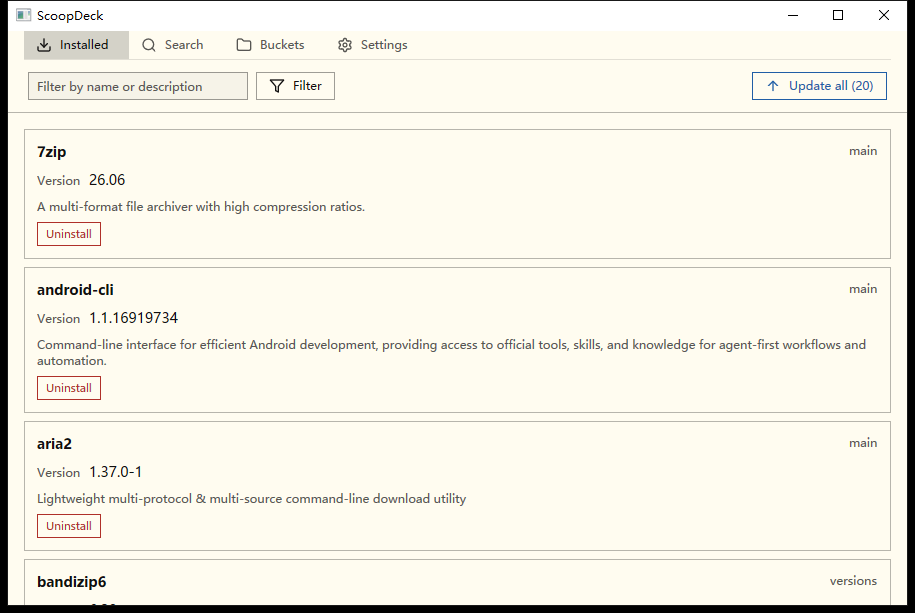
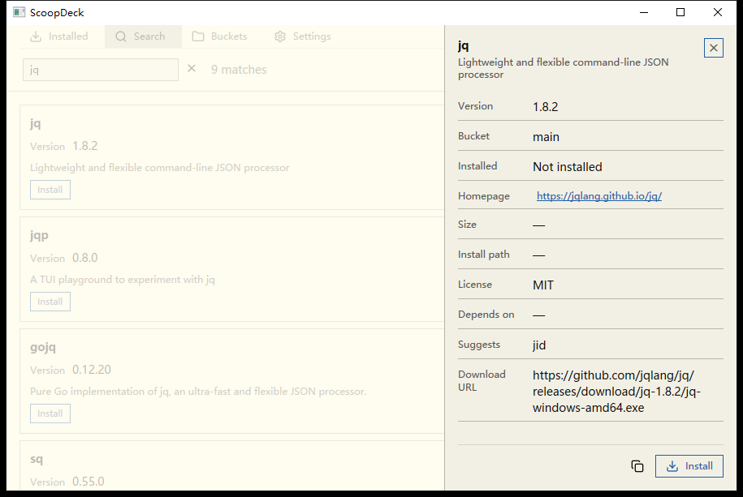
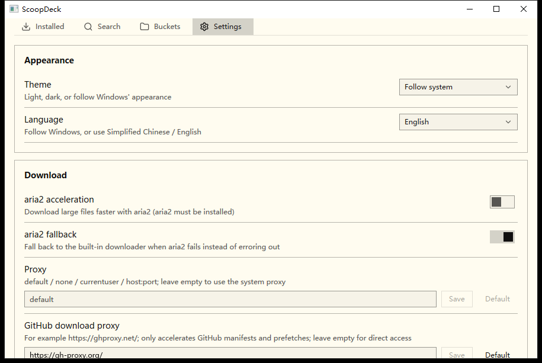

# ScoopDeck


$)

[English](./README.md) | 简体中文

Windows 上的 [Scoop](https://scoop.sh) 图形界面。界面用 TSX（[nsh](https://nsh.dev)）编写，读写 Scoop 目录、清单、缓存和配置的工作交给 Rust；真正的安装、更新与卸载仍由 `scoop` 执行。

ScoopDeck 不另建一套包数据库，而是把本机的 Scoop 环境整理成可搜索、可筛选、可排队的桌面界面。关闭窗口后应用留在系统托盘继续下载，真正退出请使用托盘菜单的「退出」。

> 仅支持 Windows 10 1809+ 和 Windows 11。界面支持简体中文和英文，默认跟随 Windows 语言，可在设置中切换。

## 截图

| 已安装 | 包详情 |
| --- | --- |
|  |  |



## 功能

### 已安装

- 列出包名、已安装版本、最新版本、来源 bucket 和描述。
- 按关键词、更新状态（全部 / 有更新 / 已最新）和来源 bucket 筛选。
- 单个更新或卸载；「全部更新」跟随当前筛选结果。
- 详情侧栏显示主页、许可证、依赖、建议、下载地址、备注、安装路径、占用空间和清单路径，可一键复制包名。
- 在窗口外通过 `scoop` 安装或卸载后，切回窗口会自动刷新列表。

### 搜索与安装

- 聚合本机所有已添加 bucket 的清单，按包名和描述搜索（不提供远程在线索引）。
- 排序优先级：名称完全匹配 → 名称前缀 → 名称包含 → 描述包含；同级短名称优先。单次最多显示 100 条。
- 安装前用清单里的下载地址做一次 `HEAD` 请求估算大小；拿不到 `Content-Length` 时显示「下载大小未知」。
- 已安装的包在搜索结果里标记为「✓ 已安装」。

### 下载与安装队列

- 下载最多 3 个并行，安装和卸载严格串行（一次一个）。
- 进度阶段包括准备、下载、校验、解压和收尾；能拿到百分比时显示百分比，否则显示阶段文字。
- 排队中、待安装和下载中的任务可以取消；进入校验、解压、收尾阶段后不再允许取消，避免留下装了一半的应用。卸载不可取消。
- 失败的任务保留在队列里，支持重试或忽略；一批任务结束后汇总成功和失败数量。
- 队列面板停在窗口底部，默认收起；有任务时点击「队列（n）」展开，窄窗口下也能随时收起以腾出列表空间。
- 托盘图标提示当前活动和队列数量；应用单实例运行，第二次启动会唤起已有窗口，并自动记住窗口大小和位置。

### Bucket

- 查看已添加的 bucket、清单数量和 git 来源地址。
- 从 Scoop 自带的已知 bucket 列表一键添加，或输入名称和仓库地址添加自定义 bucket。
- 修改 bucket 的 origin 地址，或删除 bucket（删除只移除本机清单，不会卸载已安装的包）。

### 设置与维护

- 直接读写 `%USERPROFILE%\.config\scoop\config.json`（原子替换并保留未知键），支持常用开关、代理、默认架构、shim、Scoop 仓库/分支、GitHub token 等白名单配置项。
- ScoopDeck 专属的 GitHub 下载代理（例如 `https://ghproxy.net/`）只作用于 GitHub 清单与预下载，不写入 Scoop 配置。
- 一键运行 `scoop update`（「立即更新」）更新 Scoop 自身和所有 bucket。
- 外观可跟随系统、固定浅色（Flexoki Light）或固定深色（Tokyo Night），立即生效并持久化。
- 界面语言可跟随系统、固定简体中文或 English，立即生效并持久化。
- 导出 `scoop export` 生成的 Scoopfile，或从 Scoopfile 导入 bucket 和缺失的应用（导入期间锁定其它耗时操作）。
- 查看下载缓存占用、清理下载缓存、清理所有应用的旧版本目录。
- 窗口宽度小于 900 时，表格自动切换为卡片布局，设置项改为上下排布。

## 安装与运行

### 环境要求

- Windows 10 1809+ 或 Windows 11。
- 已安装并可用的 [Scoop](https://scoop.sh)（`scoop` 不在 `PATH` 时，ScoopDeck 也会尝试默认安装目录）。
- 若未安装 Scoop，可在普通用户 PowerShell 中执行：
  ```powershell
  Set-ExecutionPolicy RemoteSigned -Scope CurrentUser
  irm get.scoop.sh | iex
  ```

### 从源码运行或打包

构建 ScoopDeck 需要以下工具：

1. **Rust 工具链**（[rustup](https://rustup.rs)，Edition 2024 需 Rust 1.85+）：选择 MSVC 工具链，并在 Visual Studio Build Tools 中勾选「使用 C++ 的桌面开发」和 Windows SDK。
2. **nsh CLI**（`>= 0.7.1`）：
   ```powershell
   irm https://nsh.dev/install.ps1 | iex
   # 或通过 Scoop 安装：
   scoop install https://github.com/longbridge/nsh/releases/latest/download/nsh.json
   ```

在项目根目录执行：

```powershell
# 启动开发模式（首次编译耗时较长）
nsh run

# 或打包独立 Windows 应用（输出至 .nsh\out）
nsh package --target windows
```

> 启动后如果提示「未检测到 Scoop」，先按界面引导安装 Scoop，再点「重新检测」；仍然失败时重启一次 ScoopDeck。

### 用 Scoop 安装

Release 页面附带带有压缩包哈希的 `scoop-deck.json` 清单：

```powershell
scoop install https://github.com/JQiue/scoop-deck/releases/download/v0.1.0/scoop-deck.json
scoop update scoop-deck
```

清单会安装 release 里的 zip，创建开始菜单快捷方式，并把 `nsh/` 运行时放在可执行文件旁边；后续用 `scoop update scoop-deck` 更新。

## 工作原理与数据路径

### 核心机制

- **已安装列表**：读取 `<Scoop 根目录>\apps\<包名>\current` 下的清单，同时兼容新命名 `scoop-manifest.json` / `scoop-install.json` 与旧命名 `manifest.json` / `install.json`。最新版本从对应 bucket 清单读取；通过 URL 清单安装的包会优先请求远端清单，网络失败时退回本机清单。
- **可安装清单缓存**：扫描 `<Scoop 根目录>\buckets\<bucket>\bucket\*.json`，按每个 bucket 的 git HEAD（非 git bucket 用目录修改时间）生成签名，缓存到 `%LOCALAPPDATA%\ScoopDeck\catalog.json`。bucket 未变化时直接复用缓存。
- **预下载与回退**：按当前架构选出下载地址，严格遵循 Scoop 缓存命名规则 `<包名>#<版本>#<原始 URL（含 fragment）的 SHA-256 前 7 位><扩展名>`；先写 `<文件名>.download` 并校验哈希，完成后重命名并交给 `scoop install` 或 `scoop update`。预下载失败不会中断安装，而是自动回退给 Scoop 自行下载。
- **进度解析**：当输出被重定向时，Scoop 仍会打印 `Downloading <url> (<size>)`；ScoopDeck 据此获取总大小并观察缓存文件增长来计算百分比，同时根据输出识别校验、解压和收尾阶段。

### 数据与状态文件

| 路径 | 用途 |
| --- | --- |
| `%USERPROFILE%\.config\scoop\config.json` | Scoop 配置文件（设置页仅改写白名单键，特意排除需 Scoop 副作用的 `use_sqlite_cache`）。 |
| `%LOCALAPPDATA%\ScoopDeck\settings.json` | ScoopDeck 自身设置（如 GitHub 下载代理）。 |
| `%LOCALAPPDATA%\ScoopDeck\catalog.json` | 可安装清单缓存；删除后重启可强制重新扫描所有 bucket。 |
| `%APPDATA%\io.github.jqiue.scoopdeck\storage.json` | 界面本地状态：窗口位置与尺寸、外观主题偏好、界面语言偏好。 |
| `<Scoop 根目录>\cache\` | Scoop 下载缓存（默认 `%USERPROFILE%\scoop\cache`），可在设置页清理。 |

## 技术栈与项目结构

| 层 | 技术选型 |
| --- | --- |
| 界面 | TSX、[nsh](https://nsh.dev)、[nsh-omarchy](https://huacnlee.github.io/nsh-omarchy/) 组件库、Tailwind 风格样式、Flexoki Light / Tokyo Night 主题 |
| 原生后端 | Rust 2024、`nsh-core` 0.7.1、`#[native_module("scoop-deck/native")]` |
| 数据与网络 | `serde`、`serde_json`、`sha2`、`ureq`（支持断点续传与 GitHub 代理） |
| 外部调用 | `scoop`（PowerShell）、`git`、PowerShell + WinForms 文件对话框 |

没有 Node.js 或 npm 依赖；TSX 通过 `scoop-deck/native` 调用 Rust 导出的 `Scoop` 模块，构建、类型检查和打包均由 `nsh` 完成。

```text
.
├─ App.tsx                 # nsh 入口，转发导入 ui/App
├─ nsh.json / nsh.lock     # 应用配置与 nshm 组件库锁定版本
├─ theme.json              # Flexoki Light / Tokyo Night 主题 token
├─ locales/app.yml         # 简体中文与英文翻译
├─ Cargo.toml              # Rust crate（scoop-deck）
├─ assets/                 # 应用图标
├─ ui/
│  ├─ assets/tray.png      # 系统托盘图标
│  ├─ App.tsx              # 窗口、标签页、托盘、启动检查
│  ├─ deck.ts              # 共享信号、加载器、详情与 bucket 操作
│  ├─ queue.ts             # 下载/安装队列、取消、重试
│  ├─ filters.ts           # 已安装列表筛选
│  ├─ search.ts            # 清单搜索与排序
│  ├─ omarchy.ts           # 统一的 nsh-omarchy 组件转出口
│  ├─ theme.ts             # 外观选择（跟随系统/浅色/深色）与持久化
│  ├─ i18n.ts              # 语言选择（跟随系统/中文/英文）与持久化
│  ├─ InstalledTab.tsx     # 已安装页
│  ├─ SearchTab.tsx        # 搜索页
│  ├─ BucketsTab.tsx       # Bucket 管理页
│  ├─ SettingsTab.tsx      # 设置页
│  ├─ DetailSheet.tsx      # 包详情侧栏
│  ├─ JobSlot.tsx          # 列表行内的任务状态与操作
│  ├─ QueueDock.tsx        # 窗口底部可收起的队列面板
│  ├─ ScoopSetup.tsx       # 未检测到 Scoop 时的引导页
│  ├─ ErrorBanner.tsx      # 顶部浮动错误提示（ErrorToast，支持展开与复制）
│  ├─ ui.tsx               # 共用样式、格式化与窄窗口判断
│  ├─ types.ts             # 共用类型和取消规则
│  └─ App.test.tsx         # 无头界面测试
├─ src/
│  ├─ lib.rs               # Scoop API、清单读取、catalog 缓存、测试
│  ├─ download.rs          # 预下载、缓存命名、哈希校验、GitHub 代理
│  ├─ process.rs           # scoop 子进程、进度解析、取消与清理
│  └─ settings.rs          # config.json 读写、缓存统计、导入导出
└─ AGENTS.md               # 开发约定与 Scoop 集成内部规范
```

## 开发命令

| 命令 | 作用 |
| --- | --- |
| `nsh run` | 启动开发宿主（TSX 热更新；修改 Rust 后自动重编译并重启宿主）。 |
| `nsh check` | TypeScript 类型检查 + `cargo check`，并重新生成 `.nsh/` 类型与宿主 crate。修改导出的 Rust 签名后必须运行。 |
| `nsh test` | 运行 Rust 单元测试与 `ui/App.test.tsx` 无头测试（约 15–20 秒）。 |
| `nsh package --target windows` | 打包 Windows 应用，产物位于 `.nsh\out`。 |
| `nsh add nsh-omarchy` / `nsh upgrade` | 安装或升级 `nsh.json` 中的 nshm 组件依赖。 |
| `cargo fmt` | 格式化 Rust 代码（`nsh check` 不会自动格式化）。 |

涉及真实 Scoop 缓存、桌面或网络的测试默认标记为 `#[ignore]`，可手动执行：

```powershell
cargo test --manifest-path .nsh\rust\Cargo.toml -p scoop-deck -- --ignored
```

完成修改前请在本地运行 `nsh check`、`nsh test` 和 `cargo fmt`。组件使用细节、框架踩坑说明及 Scoop 集成红线请参见 [AGENTS.md](AGENTS.md)。

开发在 `dev` 分支进行。发布时把 `dev` 合并到 `main`，版本 tag（`v0.1.0` 等）只打在 `main` 的提交上；release workflow 会拒绝不在 `main` 上的 tag。

## 故障排查

- **搜索页没有可安装包**：本机还没有添加 bucket，或清单缓存过期。去 Bucket 页添加来源，或在设置页运行「立即更新」；也可以删除 `%LOCALAPPDATA%\ScoopDeck\catalog.json` 后重启。
- **下载失败或一直等待数据**：检查网络和代理。访问 GitHub 较慢时可在设置页填写「GitHub 下载代理」；预下载失败时会自动回退给 Scoop 下载。详细报错可点击顶部浮动错误提示展开查看并复制。
- **点击关闭后进程还在**：关闭窗口只会隐藏到系统托盘，以便后台继续下载。右键托盘图标选择「退出」即可结束进程。
- **任务没有取消按钮**：安装已进入校验、解压或收尾阶段，此时强行终止会损坏应用目录，需等待当前包执行完毕。
- **`no module scoop-deck/native` 或升级 `nsh` 后编译报错**：`.nsh/` 目录中的生成代码已过期，删除 `.nsh` 目录后重新执行 `nsh check` 或 `nsh run` 即可重新生成。

## 许可

[MIT](LICENSE) © 2026 JQiue
